# Projektdokumentation – Angular Academy & React Academy

Stand: 10.11.2026 · gilt für beide Repos (die Datei ist in beiden gleich)

| | Angular Academy | React Academy |
|---|---|---|
| Live | <https://angular-academy-de.netlify.app> | <https://react-academy-de.netlify.app> |
| Repo | [JuliusMarx/angular-academy](https://github.com/JuliusMarx/angular-academy) | [JuliusMarx/react-academy](https://github.com/JuliusMarx/react-academy) |
| Inhalt | 14 Kapitel, 52 Lektionen, 40 Übungen | 14 Kapitel, 58 Lektionen, 43 Übungen |
| Beispiele laufen auf | Angular 21 | React 19, Vite 7, React Router 8 |
| Deploy | automatisch bei jedem Push auf `main` | manuell per Netlify-CLI |

---

## Inhalt

1. [Worum es geht](#1-worum-es-geht)
2. [Architektur im Überblick](#2-architektur-im-überblick)
3. [Technik](#3-technik)
4. [Projektstruktur](#4-projektstruktur)
5. [Vom Markdown zur Website (Inhalts-Pipeline)](#5-vom-markdown-zur-website-inhalts-pipeline)
6. [Funktionen für Lernende](#6-funktionen-für-lernende)
7. [Konten und Cloud-Abgleich](#7-konten-und-cloud-abgleich)
8. [Statistik und Admin-Dashboard](#8-statistik-und-admin-dashboard)
9. [Datenmodell](#9-datenmodell)
10. [Sicherheit und Datenschutz](#10-sicherheit-und-datenschutz)
11. [Qualität: Tests, CI, Barrierefreiheit, Performance](#11-qualität-tests-ci-barrierefreiheit-performance)
12. [Deployment und Betrieb](#12-deployment-und-betrieb)
13. [Unterschiede zwischen den beiden Academies](#13-unterschiede-zwischen-den-beiden-academies)
14. [Grenzen und offene Punkte](#14-grenzen-und-offene-punkte)

---

## 1. Worum es geht

Zwei interaktive Lernplattformen im Stil von W3Schools – eine für **Angular**, eine für **React**. Jede Lektion ist kurz, erklärt ein Thema mit Codebeispielen und endet mit einem Quiz. Die Beispiele laufen **als echte Projekte direkt im Browser** (StackBlitz), Übungen prüfen den Code der Lernenden automatisch. Alles gibt es auf **Deutsch und Englisch**.

Die React Academy ist ein **Fork** der Angular Academy: Die Plattform selbst (die Website) ist in beiden Fällen eine Angular-App. Unterschiedlich sind nur die Inhalte (`content/`), die Beispiele (`examples/`) und ein paar Texte.

Grundsätze:

- **Statisch und schnell:** Jede Seite wird beim Build vorgerendert. Es gibt keinen eigenen Server.
- **Ohne Zwang zum Konto:** Der Lernstand liegt im Browser. Ein Konto ist freiwillig und synchronisiert nur.
- **Datensparsam:** keine Cookies, kein Tracking durch Dritte, Seitenaufrufe ohne Besucher-Kennung.
- **Barrierefrei:** Jede Seite wird automatisch mit axe geprüft (WCAG AA).

---

## 2. Architektur im Überblick

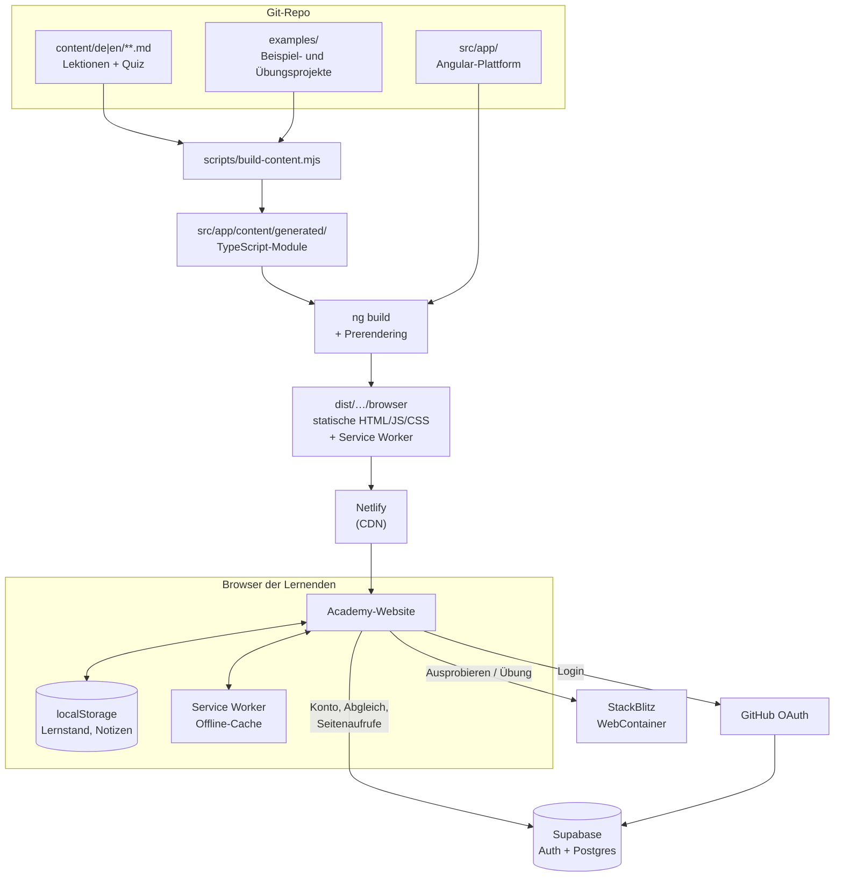

**Wer macht was?**

| Baustein | Aufgabe |
|---|---|
| **Netlify** | liefert die fertigen Dateien aus, setzt Header und Weiterleitungen (`netlify.toml`) |
| **Service Worker** | speichert die App im Browser, damit sie offline läuft |
| **StackBlitz** | startet die Live-Beispiele als echte Node-Projekte im Browser (WebContainer) |
| **Supabase** | Konten (GitHub- und E-Mail-Login), Lernstand in der Cloud, Seitenaufrufe, Admin-Statistik |
| **GitHub** | Code, CI (GitHub Actions), OAuth-Login, „Fehler melden“-Issues |

---

## 3. Technik

| Bereich | Technik |
|---|---|
| Plattform | Angular 22 (Standalone-Komponenten, Signals, zoneless, OnPush), SSR nur zum Vorrendern (`outputMode: static`) |
| Inhalte | Markdown + YAML-Frontmatter → `gray-matter`, `marked`, Syntax-Highlighting mit `shiki` |
| Suche | `minisearch` (Index wird beim Build erzeugt) |
| Live-Beispiele | `@stackblitz/sdk`, Cross-Origin-Isolation per COOP/COEP-Header |
| Offline | `@angular/service-worker` (`ngsw-config.json`) + Web-App-Manifest |
| Konten | `@supabase/supabase-js` (wird nur bei Bedarf geladen), PKCE-Flow |
| Tests | Vitest (Unit), Playwright + axe-core (E2E und Barrierefreiheit) |
| Hosting | Netlify (statisch), Supabase (Region Frankfurt) |

---

## 4. Projektstruktur

```
content/<de|en>/<NN-kapitel>/
  _chapter.md                 Kapitel: Titel, Beschreibung, Frage für den Einstufungstest
  <NN-lektion>.md             Lektion: Text + Frontmatter (title, minutes, summary, quiz, exercise)
examples/
  _base/                      gemeinsames Grundprojekt aller Beispiele
  _exercise-kit/              Prüf-Kit für Übungen (prüft die laufende App)
  _test-kit/, _test-exercise-kit/   Vitest-artiger Runner im Browser, Mutationstests
  _e2e-kit/, _e2e-exercise-kit/     Playwright-Nachbau im Browser (nur Angular)
  <beispiel-id>/              Dateien, die _base ergänzen/überschreiben (+ meta.json)
scripts/
  build-content.mjs           Markdown + Beispiele → TypeScript-Module
src/app/
  content/                    Datenmodell, ContentService, Glossar, generated/
  core/                       Fortschritt, Cloud, Statistik, Suche, Theme, Lesemodus, UI-Texte, site.ts
  layout/                     Shell, Header, Seitenleiste, Suchdialog, Update-Hinweis
  pages/                      alle Seiten (siehe Abschnitt 6)
  shared/                     Fortschrittsbalken, SafeHtml-Pipe
e2e/                          Playwright-Tests der Plattform
docs/                         diese Doku, Einrichtung der Konten (cloud-setup.md)
public/                       Icons, Manifest, serve.json (lokaler Testserver wie Netlify)
netlify.toml                  Build, Weiterleitungen, Header
ngsw-config.json              was der Service Worker speichert
```

**Wichtige Dateien in `src/app/core/`**

| Datei | Inhalt |
|---|---|
| `site.ts` | alles, was sich zwischen den Forks unterscheidet: Repo- und Seiten-URL, Speicherpräfix, Betreiberangaben fürs Impressum, Supabase-Zugang |
| `ui-text.ts` | alle Texte der Oberfläche auf Deutsch und Englisch |
| `progress.service.ts` | Lernstand im Browser (siehe 6.5) |
| `cloud.service.ts` | Login, Abgleich mit Supabase, Admin-Abfragen |
| `progress-merge.ts` | führt zwei Lernstände zusammen |
| `analytics.service.ts` | zählt Seitenaufrufe |

---

## 5. Vom Markdown zur Website (Inhalts-Pipeline)

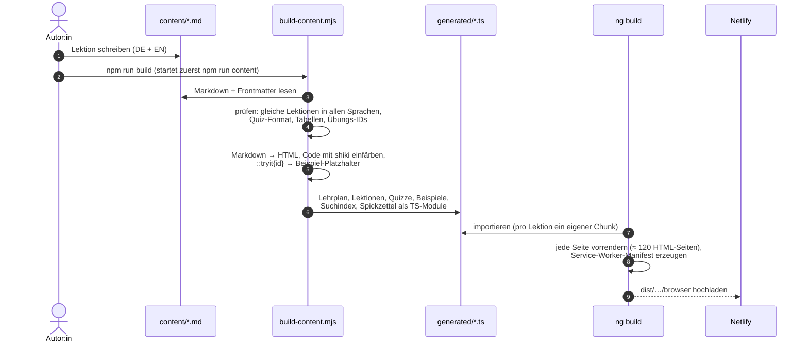

- **URLs** kommen aus den Ordner- und Dateinamen ohne Nummer: `content/de/02-templates/01-interpolation.md` → `/de/templates/interpolation`.
- **Fehler im Inhalt brechen den Build ab** (fehlende Übersetzung, kaputtes Quiz, Prüf-IDs, die nicht zu `checks.ts` passen, leere Tabellenköpfe).
- Wie man Lektionen und Übungen schreibt, steht im [README](../README.md).

---

## 6. Funktionen für Lernende

### Seitenübersicht

| Pfad | Seite |
|---|---|
| `/de`, `/en` | Startseite: Lernweg wählen (Kurz/Ausführlich), Kapitelübersicht, Werkzeuge, Fortschritt verwalten |
| `/de/<kapitel>/<lektion>` | Lektion |
| `/de/placement` | Einstufungstest |
| `/de/review` | Wiederholen |
| `/de/cheatsheet` | Spickzettel |
| `/de/glossary` | Glossar |
| `/de/notes` | Notizen & Lesezeichen |
| `/de/certificate` | Zertifikat |
| `/de/account` | Konto (Login, Abgleich) |
| `/de/admin` | Admin-Dashboard (nur Admins) |
| `/de/imprint`, `/de/privacy` | Impressum, Datenschutz |

`/` leitet je nach Browsersprache auf `/de` oder `/en` weiter.

### 6.1 Lektionen

Jede Lektion hat Text, Codeblöcke, Hinweisboxen, Live-Beispiele, ein Quiz und manchmal eine Übung. Oben gibt es den Umschalter **Kurz / Ausführlich**:

- **Kurz** zeigt nur die Kernpunkte (`summary` im Frontmatter), die Beispiele, das Quiz und die Übung – ein Schnellkurs.
- **Ausführlich** zeigt den ganzen Text.

Die Wahl gilt für alle Lektionen und wird gespeichert. Daneben: **Lektion merken** (Lesezeichen), am Ende **Notizen** zur Lektion, **„Als erledigt markieren“**, Links zur vorherigen/nächsten Lektion und **„Fehler in dieser Lektion melden“** (öffnet ein vorausgefülltes GitHub-Issue). Ein Inhaltsverzeichnis rechts springt zu den Abschnitten.

### 6.2 Live-Beispiele („Ausprobieren“)

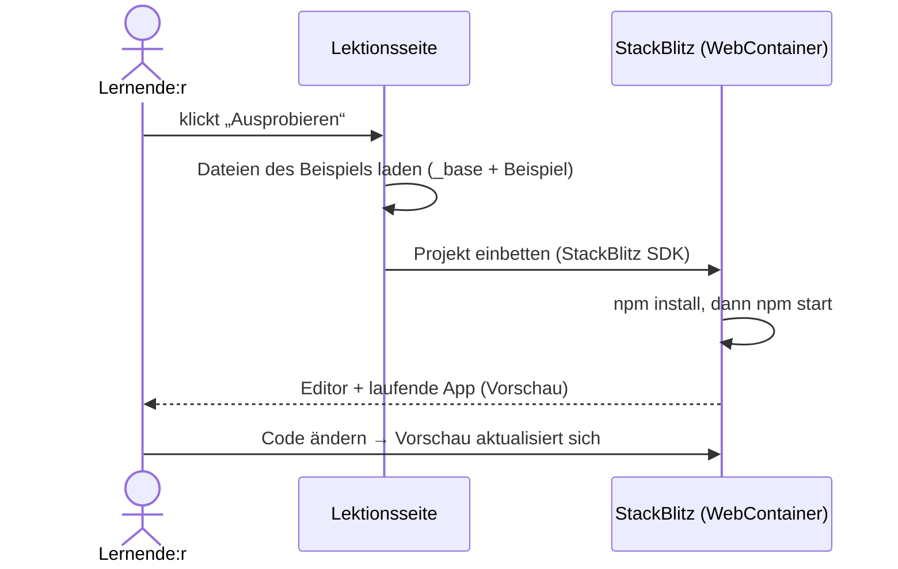

StackBlitz wird **erst beim Klick** geladen (Datenschutz, Ladezeit). Damit die WebContainer laufen, schickt die Seite die Header `Cross-Origin-Opener-Policy: same-origin` und `Cross-Origin-Embedder-Policy: credentialless`. „In StackBlitz öffnen“ öffnet das Projekt im neuen Tab.

### 6.3 Übungen mit automatischer Prüfung

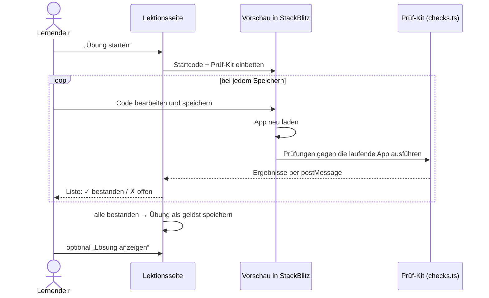

Varianten:

- **Normale Übung:** Prüfungen klicken und tippen in der laufenden App und prüfen das Ergebnis.
- **Test-Übung** (`"kit": "test"`): Die Lernenden schreiben Tests. Geprüft wird per **Mutationstest**: Die Tests müssen gegen den echten Code bestehen und gegen absichtlich kaputte Varianten („Mutanten“) fehlschlagen.
- **UI-Test-Übung** (`"kit": "e2e"`, nur Angular): dasselbe mit Playwright-Tests, die im Browser gegen die App laufen.

### 6.4 Quiz

Jede Lektion endet mit Multiple-Choice-Fragen. Nach dem Absenden gibt es pro Frage eine Erklärung. Das Ergebnis wird gespeichert, **falsch beantwortete Fragen landen im Wiederholen-Stapel** (6.7).

### 6.5 Fortschritt

Der Lernstand wird **im Browser** gespeichert (`localStorage`, Schlüssel `<präfix>.progress`):

- erledigte Lektionen, Quiz-Ergebnisse, gelöste Übungen,
- Wiederholen-Stapel, Notizen, Lesezeichen,
- Zertifikat (Name, Datum), zuletzt besuchte Lektion.

Angezeigt wird er in der Seitenleiste (Häkchen, Gesamtbalken) und auf der Startseite (pro Kapitel). Unter **„Fortschritt verwalten“** auf der Startseite:

- **Übertragungscode:** Den Stand als Code kopieren und auf einem anderen Gerät einfügen (ohne Konto).
- **Export/Import** als JSON-Datei.
- **Zurücksetzen.**

Mit einem Konto geht das automatisch (Abschnitt 7).

### 6.6 Einstufungstest

Eine Frage pro Kapitel (14 Fragen). Wer eine Frage richtig beantwortet, kann das ganze Kapitel als erledigt markieren und direkt weiter vorne einsteigen. Welche Frage gestellt wird, steht in `_chapter.md` (`placement:`).

### 6.7 Wiederholen (Leitner-System)

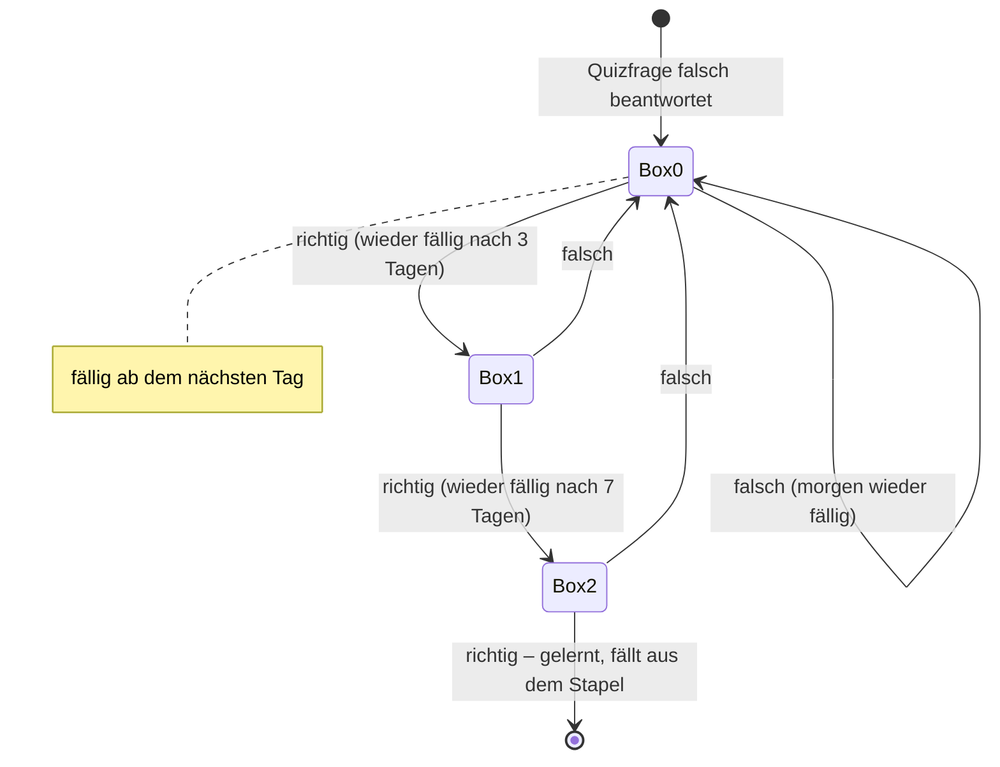

Die Seitenleiste zeigt, wie viele Fragen fällig sind. Fragen, die es im Inhalt nicht mehr gibt, werden automatisch entfernt.

### 6.8 Spickzettel, Glossar, Suche

- **Spickzettel:** alle Kurzfassungen aller Lektionen auf einer Seite – zum Nachschlagen und Drucken.
- **Glossar:** rund 40 Fachbegriffe mit kurzer Erklärung, Filterfeld, A–Z-Navigation und Links zu den Lektionen.
- **Suche** (Lupe oben oder **Strg+K** / **/**): Volltextsuche über alle Lektionen mit Treffervorschau, springt direkt zur passenden Stelle.

### 6.9 Notizen, Lesezeichen, Zertifikat

- **Notizen** werden beim Tippen automatisch gespeichert (nach 0,6 s), **Lesezeichen** per Stern in der Lektion. Beides sammelt die Seite **Notizen & Lesezeichen**, in Kursreihenfolge und druckbar.
- **Zertifikat:** Wer alle Lektionen erledigt hat, gibt einen Namen ein und bekommt ein druckbares Zertifikat. Das Datum bleibt das der ersten Ausstellung.

### 6.10 Offline-Modus und Updates

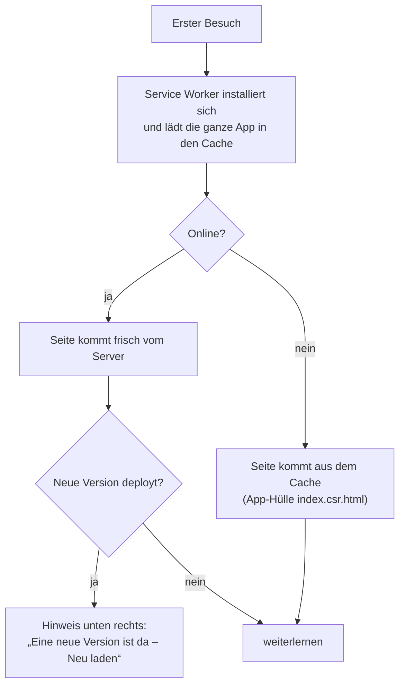

Offline gehen alle Lektionen, Quiz, Notizen und der Fortschritt. Nicht offline gehen: StackBlitz-Beispiele und der Cloud-Abgleich (holt nach, sobald man wieder online ist). Die Seiten lassen sich als App installieren („Zum Startbildschirm“).

### 6.11 Oberfläche

- **Sprache** DE/EN oben rechts – bleibt auf derselben Seite.
- **Hell/Dunkel** (Mond/Sonne), richtet sich zuerst nach dem System.
- **Anmelden** oben rechts (auf dem Handy nur das Personen-Symbol), angemeldet mit Anfangsbuchstabe und Name.
- **Mobil:** Die Seitenleiste wird zum ausklappbaren Menü (☰).

---

## 7. Konten und Cloud-Abgleich

Ein Konto ist freiwillig. Anmelden geht **mit GitHub** oder **mit E-Mail und Passwort**. Ein Konto gilt für beide Academies; jede speichert ihren eigenen Lernstand.

### 7.1 Anmeldung mit GitHub

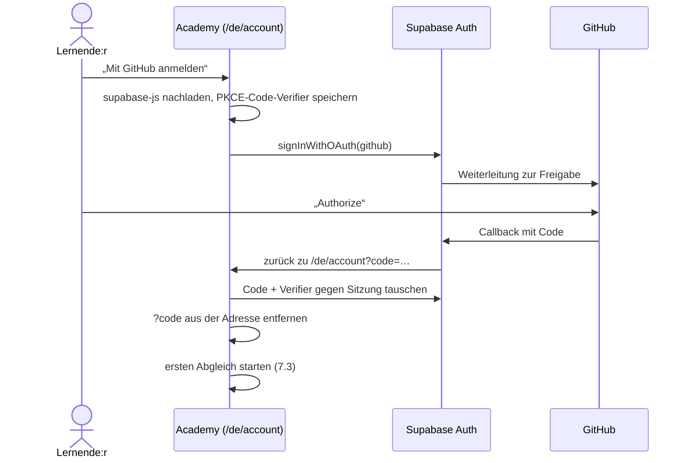

### 7.2 Anmeldung mit E-Mail und Passwort

- **Registrieren:** E-Mail + Passwort (mind. 8 Zeichen) → das Konto ist sofort aktiv. In Supabase ist „Confirm email“ ausgeschaltet, weil kein eigener Mailserver eingerichtet ist.
- **Anmelden:** E-Mail + Passwort.
- **Passwort vergessen** ist ausgeblendet, solange `SITE.cloud.emails` `false` ist (ohne Mailversand geht es nicht). Mit SMTP-Zugang in Supabase und `emails: true` erscheinen Bestätigungs- und Zurücksetzen-Mails automatisch.
- Fehler (falsches Passwort, Konto existiert schon …) werden übersetzt angezeigt.

### 7.3 So funktioniert der Abgleich

Der Lernstand bleibt immer **im Browser** die Grundlage; die Cloud ist eine Kopie.

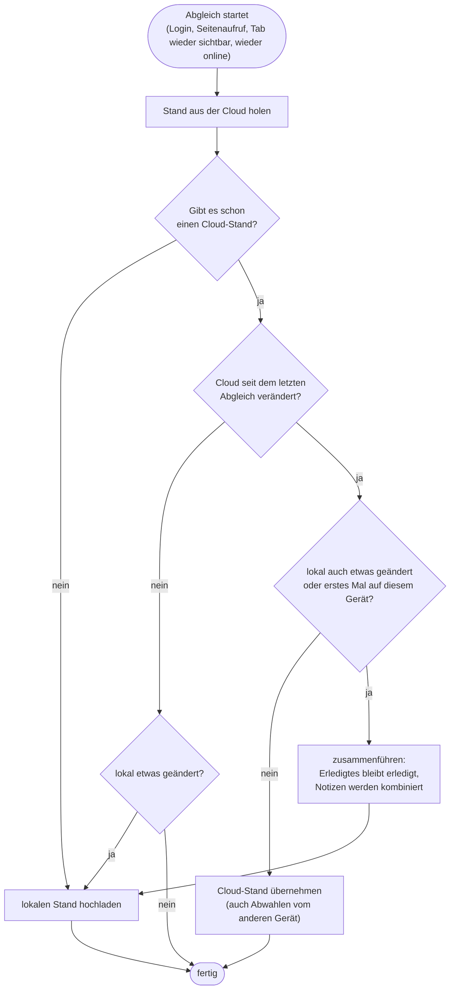

- Jede lokale Änderung wird nach **2 Sekunden** hochgeladen (mehrere Änderungen werden ein Upload).
- Die Seite merkt sich in `<präfix>.cloud`, auf welchem Cloud-Stand (`updated_at`) der lokale Stand beruht und ob es noch nicht hochgeladene Änderungen gibt – das übersteht auch Offline-Phasen und Neuladen.
- **Zusammenführen** (`progress-merge.ts`): Listen werden vereinigt, Quiz-Ergebnisse nach Datum, Wiederholen-Fragen in der niedrigeren Box, Notizen kombiniert (ohne doppelten Text), Zertifikat mit dem frühesten Datum.
- **Abmelden** lässt den Stand im Browser. **Konto löschen** entfernt Konto und Cloud-Daten (beider Academies), der Stand im Browser bleibt.

---

## 8. Statistik und Admin-Dashboard

### 8.1 Zählung der Seitenaufrufe

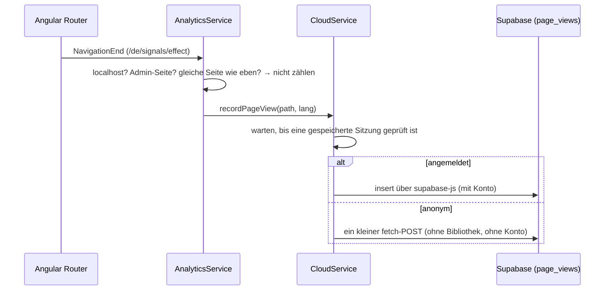

Gespeichert werden **nur**: Academy, Seite, Sprache, Zeit und – wenn angemeldet – das Konto. Keine Cookies, keine Besucher-ID, keine IP-Adresse in der Tabelle. Aufrufe von `localhost` (Entwicklung, Tests) zählen nicht; zum Ausprobieren lässt sich das mit `localStorage.setItem('<präfix>.track-local', '1')` einschalten.

### 8.2 Dashboard (`/de/admin`)

Sichtbar nur für Konten in der Tabelle `admins` (aktuell: das GitHub-Konto *JuliusMarx*). Dann erscheint „Admin ▦“ in der Seitenleiste und ein Link auf der Kontoseite.

| Bereich | Inhalt |
|---|---|
| Filter | Academy (Angular/React – beide liegen in derselben Datenbank), Zeitraum 7/30/90 Tage |
| Kachel Seitenaufrufe | Summe, heute, Anteil angemeldet |
| Kachel Konten | alle Konten, neue im Zeitraum, GitHub vs. E-Mail |
| Kachel aktive Konten | Konten mit Seitenaufruf im Zeitraum, Anmeldungen der letzten 7 Tage |
| Kachel Lernstände | Konten mit Cloud-Stand, erledigte Lektionen, Zertifikate |
| Diagramm | Seitenaufrufe pro Tag, gestapelt: angemeldet (blau) / nicht angemeldet (orange), Tooltip, Tabellenansicht |
| Top-Seiten | die 15 meistbesuchten Seiten mit Balken |

Die Zahlen liefert die Datenbankfunktion `admin_stats(app, days)`; sie prüft selbst, ob der Aufrufer Admin ist.

---

## 9. Datenmodell

### 9.1 Im Browser (`localStorage`)

`<präfix>` ist `angular-academy` bzw. `react-academy`.

| Schlüssel | Inhalt |
|---|---|
| `<präfix>.progress` | Lernstand (siehe 6.5) |
| `<präfix>.theme` | hell/dunkel |
| `<präfix>.reading-mode` | Kurz/Ausführlich |
| `<präfix>.auth` (+ `…-code-verifier`) | Supabase-Sitzung, nur mit Konto |
| `<präfix>.cloud` | Abgleich-Status: Konto-ID, Cloud-Stand, ungespeicherte Änderungen |
| `<präfix>.track-local` | optional: Zählung auf localhost einschalten |

### 9.2 In Supabase

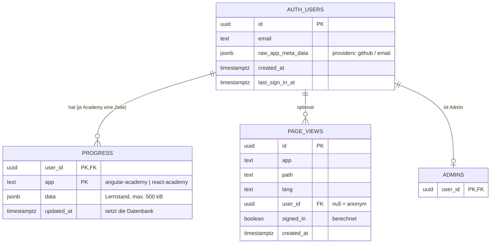

Datenbankfunktionen: `delete_my_account()`, `is_admin()`, `admin_stats(app, days)`, Trigger `touch_updated_at`. Das komplette SQL steht in [cloud-setup.md](cloud-setup.md).

---

## 10. Sicherheit und Datenschutz

**Row Level Security (RLS)** ist auf allen Tabellen an:

| Tabelle | Wer darf was |
|---|---|
| `progress` | jede Person nur ihre eigenen Zeilen (lesen, schreiben, löschen) |
| `page_views` | alle dürfen **eintragen** – aber nur anonym oder für sich selbst; **lesen darf niemand** direkt |
| `admins` | niemand über die App; nur im Supabase-SQL-Editor pflegbar |
| `admin_stats()` | nur Admins (prüft die Funktion selbst) |

Geprüft am 10.11.2026: anonymes Lesen liefert nichts, Statistik ohne Login wird abgelehnt, Eintragen unter fremdem Konto wird abgelehnt.

Weitere Punkte:

- Im Code stehen nur der **öffentliche** Publishable Key und die Projekt-URL (`site.ts`). Der Secret-Key und das GitHub-Client-Secret liegen nur in Supabase.
- Passwörter speichert Supabase gehasht.
- `noindex` (Meta-Tag und `X-Robots-Tag`): Suchmaschinen nehmen die Seiten nicht auf.
- **Datenschutzerklärung** (`/de/privacy`) beschreibt Netlify, localStorage, Konto (GitHub/E-Mail, Supabase Frankfurt), Zählung der Seitenaufrufe, StackBlitz und GitHub-Links. Die Konto-Abschnitte erscheinen nur, wenn `SITE.cloud` gesetzt ist. **Impressum** (`/de/imprint`) mit den Betreiberangaben aus `site.ts`.
- Wer etwas einbaut, das Daten speichert oder externe Inhalte lädt, muss die Datenschutzerklärung ergänzen.

---

## 11. Qualität: Tests, CI, Barrierefreiheit, Performance

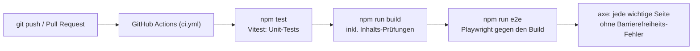

| Ebene | Was geprüft wird | Umfang (je Repo) |
|---|---|---|
| Unit (Vitest) | Fortschritt, Zusammenführen, Cloud-Abgleich mit nachgebautem Supabase, Suche, Glossar | 29 Tests |
| E2E (Playwright) | Navigation, Quiz, Fortschritt, Übertragungscode, Notizen, Glossar, Offline-Modus, Konto- und Admin-Seite, Lesemodus … | 42 Tests |
| Barrierefreiheit | axe-core (WCAG 2 A/AA + Best Practices) auf Start, Lektionen, allen Werkzeug-Seiten, Konto, Admin, Rechtsseiten | Teil der E2E-Tests |
| Inhalte | `build-content.mjs` bricht bei fehlerhaften Inhalten ab | bei jedem Build |
| Übungen | Startcode verfehlt mind. eine Prüfung, Lösung besteht alle | vor jedem Commit neuer Übungen |

**Lighthouse** (Handy-Profil, 09.11.2026): Startseiten 100/100/100 (Performance/Barrierefreiheit/Best Practices), Lektionen 94–100. SEO 63 ist gewollt (`noindex`).

Lokal:

```bash
npm test                 # Unit-Tests
npm run build            # Build (erzeugt vorher die Inhalte)
npm run e2e              # E2E gegen den Build (startet serve auf Port 4173)
```

---

## 12. Deployment und Betrieb

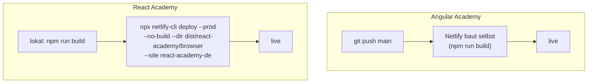

- **Netlify-Credits sind knapp:** Jeder Build der Angular Academy kostet Credits. Änderungen deshalb sammeln und gemeinsam pushen. Die React Academy wird lokal gebaut und nur hochgeladen.
- **Header** (`netlify.toml`): COOP/COEP für StackBlitz, `noindex`, `nosniff`, lange Cache-Zeit für gehashte JS/CSS, `no-cache` für den Service Worker, Manifest-Typ.
- **Service Worker:** Nach jedem Deploy sehen Besucher den Hinweis „Neu laden“.

### Häufige Aufgaben

| Aufgabe | So geht's |
|---|---|
| Lektion ändern | Markdown in `content/de` **und** `content/en` ändern, `npm run build`, Tests, pushen |
| Weiteren Admin anlegen | Supabase → SQL Editor: `insert into public.admins (user_id) values ('<id>');` (ID unter Authentication → Users) |
| Statistik leeren | SQL Editor: `delete from public.page_views;` |
| E-Mail-Versand nachrüsten | SMTP in Supabase (Authentication → Emails), „Confirm email“ wieder an, in `site.ts` `cloud.emails: true` |
| Konto-Funktion abschalten | in `site.ts` `cloud.url` und `cloud.key` leeren – die Seite ist dann wieder rein statisch |
| Betreiberangaben ändern | `site.ts` → `operator`, Datum der Datenschutzerklärung in `privacyDate` |
| Diese Doku als PDF neu erzeugen | `node scripts/docs-pdf.mjs` → `docs/PROJEKT.pdf` (braucht Chrome und Internet für Mermaid) |

Einrichtung von Supabase, GitHub-Login und SQL: [cloud-setup.md](cloud-setup.md).

---

## 13. Unterschiede zwischen den beiden Academies

| | Angular Academy | React Academy |
|---|---|---|
| Lerninhalt | Angular 21/22: Templates, Signals, DI, Routing, Signal Forms, HTTP, RxJS, Testing, SSR … | React 19: JSX, State, Effects, Hooks, Data Fetching, React Router 8, Forms & Actions, Styling, State Management … |
| Beispiel-Grundprojekt | Angular CLI, Angular 21 (Angular 22 startet nicht in WebContainern) | Vite 7 + React 19 (Vite 8 noch nicht getestet) |
| Test-Kits | Vitest-artig + Playwright-Nachbau | Vitest-artig mit echter React Testing Library |
| Kapitel 14 (Praxisprojekt) | Aufgaben-App | Notiz-App |
| Glossar | 41 Begriffe | 43 Begriffe |
| Farbe | Pink `#c2185b` | Blau `#087ea4` |
| Speicherpräfix | `angular-academy` | `react-academy` |
| Deploy | Netlify-Build bei Push | lokal bauen, CLI-Upload |

Neue Plattform-Funktionen werden in beiden Repos gleich eingebaut (die Dateien in `src/app` sind bis auf `site.ts`, `ui-text.ts` und ein paar Inhalte identisch).

---

## 14. Grenzen und offene Punkte

- **Kein Mailversand:** ohne „Passwort vergessen“ und ohne E-Mail-Bestätigung. Wer das Passwort vergisst, meldet sich per GitHub an oder schreibt dem Betreiber.
- **Seitenaufrufe sind Rohzahlen:** ohne Besucher-ID gibt es keine „eindeutigen Besucher“, Bots werden nicht gefiltert, und jeder kann theoretisch Aufrufe eintragen.
- **Live-Beispiele brauchen Internet** und einen Browser mit WebContainer-Unterstützung (Chrome/Edge am besten). Im eingebauten Browser der Claude-App bleibt die StackBlitz-Vorschau weiß.
- **Beispiele bleiben auf Angular 21 bzw. Vite 7**, bis die neueren Toolchains in StackBlitz laufen.
- **Google-Suche:** Die Seiten sind per `noindex` ausgesperrt. Zum Öffnen für Suchmaschinen das Meta-Tag in `src/index.html` und den `X-Robots-Tag` in `netlify.toml` entfernen.
